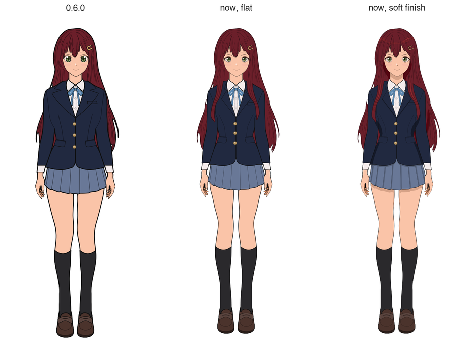
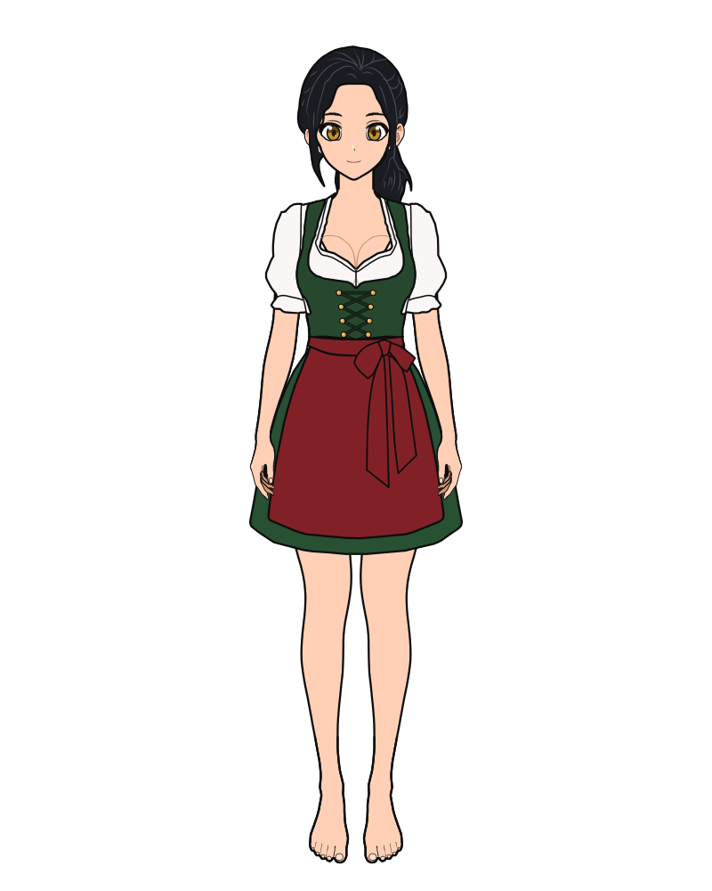

# Anime Character Creator

Anime-style characters, **drawn entirely in code**. Every hair lock, eye, fold and button is a parametric vector
shape (SVG) placed against a small skeleton of proportion anchors, so a whole cast stays on-model by construction
instead of by curating matching art. Nothing is pasted in and no image generator runs when a character is drawn.

**[Try the web tool](https://rhedak.github.io/anime-character-creator/)**: pick a character, change colours, hair, face
and clothes, choose a finish, and download the SVG or PNG. It runs in your browser, with no server.



## What's new

**0.7.1** gives Risa an open mouth that reads as a laugh: a flat upper lip, a full round lower one, a lighter
inside with teeth and a tongue, set closer to the nose. Only her cut draws it; every other character's open mouth is as before.

**0.7.0** polishes **Risa** on the adult body, stage by stage, against her
reference art (the record is [docs/risa-polish-plan.md](docs/risa-polish-plan.md)). Each step was measured against
the reference before it was judged by eye, and every other character draws exactly as before.

- **Her own proportions.** A new `body_build` setting reshapes the adult body without redrawing it: a shorter torso,
  a narrower ribcage, hips and thighs, slimmer arms. Everything worn on the body follows, raised and bent arms included.
  A silhouette gate checks the result against the reference.
- **A uniform that fits.** The blazer was refitted to the slimmer body: narrow lapels, an armhole seam that wraps the
  bust, evenly spaced buttons, and clean outlines when an arm is raised.
- **Hair in front of the shoulders.** Long locks now fall over the shoulders and the chest, as in her reference.
- **Finer line work.** A new `line_style` setting: lines at 0.6 of the house weight, the hair outlined in a dark red
  instead of black, and finer strands.
- **Her own eyes.** Traced from the reference: an almond shape with a winged lid, a three-tone iris and highlights lit
  from one side. Blinks, gaze and expressions still work.
- **The soft finish, grown.** Light and shade in the hair (a sheen across the crown, shadows behind the neck) and
  hard-edged cel shadows on skin and cloth. Risa is now drawn in the soft finish by default; everyone else stays flat.

Before that, 0.6.0 moved Risa onto the adult body, and 0.5.x gave the adult figure **poses and expressions**: arms that
raise and bend at the elbow, sleeves that follow them, and moods, blinks and a gaze, which a companion app uses for
waving, cheering and emoting.

## Status

**21 characters.** Nineteen are the tall chibi, the house figure, whose `height` (0.8 to 1.3) stretches it for a
shorter or a taller character. **Risa** and **Franzi** are drawn on the adult woman's body, about 6.4 heads tall
and traced from reference images.

| Satoko | Satoshi | Kyoko | Tomohiro |
| --- | --- | --- | --- |
|  |  |  |  |

| Chiyo | Daizen | Elara | Haruto |
| --- | --- | --- | --- |
|  |  |  |  |

| Keiko | Krista | Reika | Reinhard |
| --- | --- | --- | --- |
|  |  |  |  |

| Tenno | Viktor | Katherina | Gero |
| --- | --- | --- | --- |
|  |  |  |  |

| Linnea | Dritan | Lindita | Risa | Franzi |
| --- | --- | --- | --- | --- |
|  |  |  |  |  |

The tall chibis are first drafts, judged at the size a character is seen on a sheet; what each is still waiting on is
in [docs/character-roster-plan.md](docs/character-roster-plan.md). Franzi is shown in her dirndl; a blouse and shorts,
or her underwear alone, are options on the same controls. Kyoko and Tomohiro are Satoko and Satoshi before the dye and
the burn: one preset each and three changed fields, so the resemblance holds by construction.

`ref-out/` holds every character as transparent `.png` and `.svg`, ready to drop onto a scene (the table above uses the
`on-white/` copies, so the outline shows against a dark page). It also has a book cover (`cover.svg`) and two cast
sheets (`sheet.svg`, `sheet_satoshi.svg`), drawn by the same code.

**Two finishes.** **Flat** is the house style: flat colour, hard edges, one clean line. **Soft** is for a figure that sits
beside painted art: a graded iris and blush, tinted lines, light and shade in the hair, and on the adult figure cel
shadows. `highlight_strength` (0 to 2) sets how strong the hair's shading is. See "The soft finish" in
[docs/api.md](docs/api.md).

**Every character is an adult, twenty-one or older**, the highest common age of majority, enforced by `ADULT_FACE_AGE`
(`ts/src/model.ts`) in the tests and the web tool. **A rule for anything that uses this repository: never render a
character under twenty-one nude.** The tool draws a bare body only in a harness view for proportion work, at or above
that floor, and a consumer that draws a younger face must keep the figure clothed.

## Quick start

```bash
cd ts && npm ci && cd ..                                        # once: typescript, for the checks and the web build
node ts/bin/render.ts --out out/risa --preset risa              # writes out/risa.svg
node ts/bin/render.ts --out out/satoko --preset satoko --finish soft --highlight-strength 0.7
node ts/bin/render.ts --list                                    # the names --preset takes
```

Node 22.18 or newer runs the TypeScript directly; the drawing has no runtime dependencies. `--background` fills the
transparent canvas with any SVG paint, and every render carries a link that reproduces the exact character in its
`<metadata>` (`--no-metadata` leaves it out).

For a PNG, rasterise the SVG with cairosvg:

```bash
uv sync --project tools        # once; and `brew install cairo` on macOS
export DYLD_FALLBACK_LIBRARY_PATH=/opt/homebrew/lib:/usr/local/lib   # macOS: lets cairosvg find Homebrew's cairo
tools/.venv/bin/python harness/svg2png.py out/risa.svg out/risa.png
```

As a library, a variant is a preset with some fields replaced (see [docs/api.md](docs/api.md) for every field):

```ts
import { writeFileSync } from "node:fs";
import { replace } from "./ts/src/model.ts";
import { PRESETS } from "./ts/src/presets.ts";
import { renderCharacter } from "./ts/src/render.ts";

const risa = PRESETS["risa"]!;
// a wave, and a wider smile (mouth_curve 1 is the stock smile)
const waving = replace(risa, { right_arm_out: 6, right_elbow: 150, face: replace(risa.face, { mouth_curve: 1.2 }) });
writeFileSync("out/risa-wave.svg", renderCharacter(waving));
```

To run the web tool locally: `node web-stage.mjs --serve` and open http://127.0.0.1:8000/.

## How it works

Every shape is positioned from a **skeleton**: the head's centre and radius and the depths of the neck, shoulders,
waist, hips, knees and feet. A character is a set of parameters (`CharacterParams`: colours, a hairstyle, an `Outfit`
of garments, a `FaceStyle`), and a garment is worn when it has a colour, so characters differ by which layers they
have rather than by bespoke code. Each body part is a small function returning an SVG fragment; `renderCharacter()`
stacks them in order into one document.

The adult figure is traced from reference images and mapped onto the skeleton through one function, so a build such as
Risa's `slender` warps the body and everything worn on it at once. Shading tones are derived from a base colour
(`shade()`), never hand-picked per shape.

More in [docs/architecture.md](docs/architecture.md) (the machinery), [docs/api.md](docs/api.md) (the public surface)
and [ts/README.md](ts/README.md) (working in the code, adding a part).

## Development

```bash
cd ts && npm ci          # once
npm run typecheck        # tsc, strict
npm test                 # about a thousand tests (node:test)
cd .. && ./refresh-ref-out.sh --check && ./refresh-catalogue.sh --check && ./refresh-bases.sh --check
```

The drawing began as a Python package and was ported to TypeScript, proved byte-identical on a corpus of 7,662
characters (the tag `python-final` keeps the Python). The tests hold that output: a change that moves a byte of a
character's drawing fails them on purpose, so every visible change is a deliberate one, refreshed with
`./refresh-ref-out.sh`. Whether a shape looks right is decided by eye, against the design intent.

`main` is released code and `dev` is where work happens. [CLAUDE.md](CLAUDE.md) holds the rules a change has to respect,
and [STATUS.md](STATUS.md) the running state.

## How this was made

**This project was built with AI coding agents**, directed by its owner: mostly **Claude Code** (Anthropic), with some
work done with **Cursor** (using Grok models) and **opencode** (using the free "Big Pickle" model). AI-written code can
be wrong; the repository has a test suite, but treat it as you would any software you have not read line by line.

- **The drawing** is ordinary code: no image generator runs when a character is drawn. But the characters' designs
  began from AI-generated reference images (some made with Grok, kept in `ref/`), which set the style and the first
  roster, and several characters, Katherina, Franzi and Risa among them, were traced from such references.
- **The documentation** was written by Claude Code.
- **Commits** here carry no co-author trailer (this repository's own rule), so the history does not show which were
  AI-written: assume most of the code was.
- The companion app that uses this was built the same way and says so in its own README.

## Design principles

- **No pre-drawn art, no scraping.** Every pixel comes from shapes this code defines, which sidesteps licensing and keeps
  every character on-model.
- **Skeleton-relative, not hardcoded coordinates.** Every shape is a function of the skeleton's anchors, so proportions
  change globally without touching each shape.
- **Flat colour and hard edges by default.** The house style is cel-shaded: a garment stays one flat colour and gets its
  form from the outline and the line work. Shading planes exist only in the opt-in soft finish, as hard-edged cel
  shadows in one darker tone.
- **Measure, then judge by eye.** Reference images are guides, not targets: a measurement says what is off, and the pick
  is made by looking.
